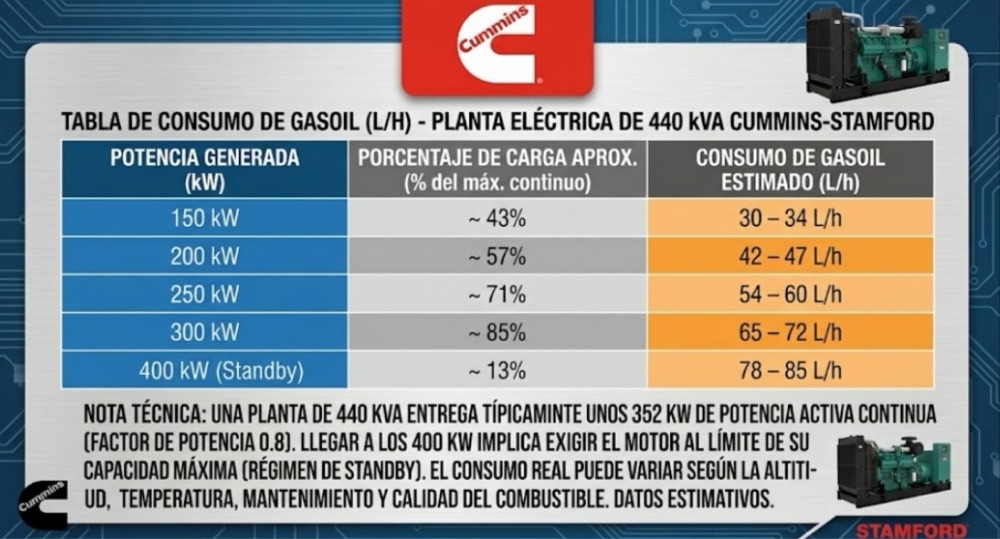
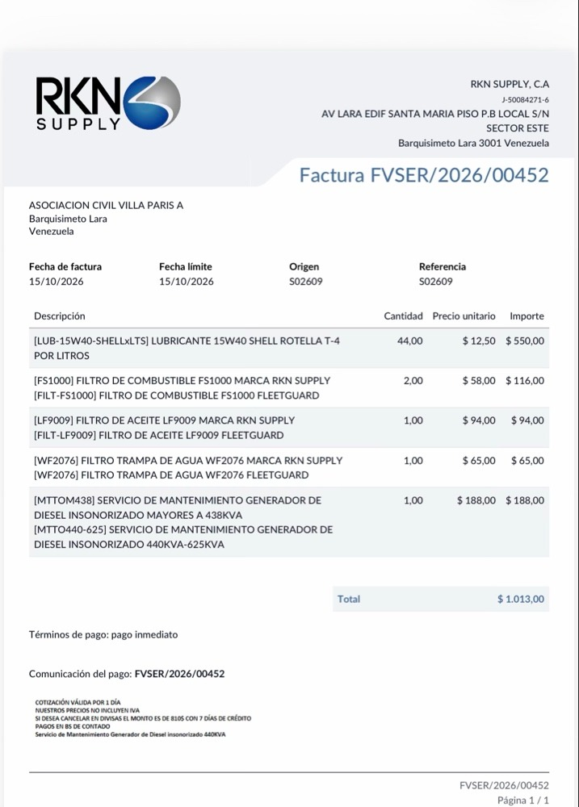

# ⚡ Cálculo Operativos Uso Generador Eléctrico — Urb. Villa París A
### Auditoría Operativa y Financiera de la Planta Eléctrica Cummins / Stamford (440 kVA)

Herramienta analítica e interactiva diseñada para la **Asociación Civil Villa París A** (Cabudare, Estado Lara, Venezuela). Permite modelar el costo real de operación horaria, mensual y anual de la planta eléctrica diésel comunitaria, integrando tanto el consumo de combustible como la amortización lineal obligatoria del mantenimiento mayor según el régimen de uso.

---

## 📋 Diagnóstico y Justificación Técnica

### 1. Régimen de Trabajo y Consumo
* **Equipo:** Generador Diésel Cummins / Stamford de 440 kVA (352 kW continuo con factor de potencia 0.8).
* **Demanda Residencial Típica:** Entre 150 kW y 250 kW (representa del 43% al 71% de la capacidad continua).
* **Demanda Promedio Verificada:** **200 kW** (~250 kVA / 57% de carga continua), equivalente a **4.0 kW por vivienda** en base a 50 casas.
* **Tasa de Consumo según Curva Cummins Oficial:**
  * **150 kW** (~43% carga · 3.0 kW/casa): **30 – 34 L/h** (promedio: 32 L/h · 4.69 kWh/L)
  * **176 kW** (50% carga nominal · 3.5 kW/casa): **38 – 41 L/h** (promedio: 39.5 L/h · 4.46 kWh/L)
  * **200 kW** (~57% carga · 4.0 kW/casa): **42 – 47 L/h** (promedio: **44.5 ≈ 45 L/h** · 4.49 kWh/L)
  * **250 kW** (~71% carga · 5.0 kW/casa): **54 – 60 L/h** (promedio: 57 L/h · 4.38 kWh/L)
  * **300 kW** (~85% carga · 6.0 kW/casa): **65 – 72 L/h** (promedio: 68.5 L/h · 4.38 kWh/L)
* **Precio Unitario del Diésel:** $1.00 / Litro.
* **Costo Horario de Combustible (a 200 kW / 45 L/h):**  
  45 L/h × $1.00/L = **$45.00 / hora**
* **Costo Energético Integral:**  
  ($45.00 combustible + $5.065 mantenimiento) ÷ 200 kWh = **$0.250 / kWh generado**



### 2. Soporte Oficial del Mantenimiento Mayor (Factura RKN Supply FVSER/2026/00452)
El servicio mayor se ejecuta estrictamente cada **200 horas** de funcionamiento:

| Descripción del Insumo / Servicio | Cantidad | P. Unitario | Subtotal |
| :--- | :---: | :---: | :---: |
| Lubricante 15W40 Shell Rotella T-4 | 44 L | $12.50 | $550.00 |
| Filtro de Combustible FS1000 Fleetguard | 2 und | $58.00 | $116.00 |
| Filtro de Aceite LF9009 Fleetguard | 1 und | $94.00 | $94.00 |
| Filtro Trampa de Agua WF2076 Fleetguard | 1 und | $65.00 | $65.00 |
| Mano de obra especializada (>438 kVA) | 1 serv | $188.00 | $188.00 |
| **Total por ciclo de 200 horas** | — | — | **$1,013.00** |



### 3. Modelo Matemático de Reserva
Para evitar derrames presupuestarios o paradas forzadas por falta de repuestos, el fondo de mantenimiento se provisiona por hora consumida:

$$\text{Costo Horario de Mantenimiento} = \frac{\$1,013.00}{200\text{ h}} = \mathbf{\$5.065\text{ / hora}}$$

$$\text{Costo Integral por Hora de Generador} = \$45.00 + \$5.065 = \mathbf{\$50.065\text{ / hora}}$$

---

## 📊 Matriz Comparativa de Cuotas por Vivienda (Base: 75 Casas · Diésel $0.98/L)

| Parámetro | 1. Recaudo Actual (4h s/mtto) | 2. Operación Sostenible (4h) | 3. Falla Habitual (6h) | 4. Falla Severa (7h) |
| :--- | :---: | :---: | :---: | :---: |
| **Horas de Uso Diario** | 4 h/día | 4 h/día | 6 h/día | 7 h/día |
| **Horas Acumuladas/Mes** | 120 h | 120 h | 180 h | 210 h |
| **Frecuencia de Mantenimiento** | Cada ~50 días | Cada ~50 días | Cada ~33 días | Cada ~28 días |
| **Gasto Mensual Gasoil ($0.98/L)** | $5,974.08 | $5,974.08 | $8,961.12 | $10,454.64 |
| **Reserva Mensual Mtto. ($5.07/h)** | $0.00 *(Descubierto)* | $607.80 | $911.70 | $1,063.65 |
| **Presupuesto Total Mensual** | **$5,974.08** | **$6,581.88** | **$9,872.82** | **$11,518.29** |
| **Déficit Mensual vs Recaudo Actual** | $0.00 | **-$607.80** | **-$3,898.74** | **-$5,544.21** |
| **Cuota Mensual por Casa (75 casas)** | **$79.65 / casa** | **$87.76 / casa** | **$131.64 / casa** | **$153.58 / casa** |
| **Costo Diario Aprox. por Casa** | ~$2.65 / día | ~$2.93 / día | ~$4.39 / día | ~$5.12 / día |

---

## 🚀 Funcionalidades de la Aplicación

1. **Simulador Paramétrico en Tiempo Real:** Control deslizante de horas diarias (1 h a 24 h), precio del combustible, consumo (L/h), intervalo y costo del servicio.
2. **Distribución Automática de Alícuotas:** Cálculo dinámico de la cuota mensual sugerida por vivienda según el censo de casas activas.
3. **Módulo de Difusión para WhatsApp:** Genera un mensaje formateado con viñetas y totales listo para pegar en el grupo de copropietarios.
4. **Modo Imprimible / Exportable a PDF:** Formato limpio y libre de elementos interactivos para carteleras o actas de asamblea.
5. **Arquitectura Zero-Dependency:** Archivo único (`index.html`) con interfaz basada en Tailwind CSS y Font Awesome cargados vía CDN.

---

## 🌐 Enlaces en Vivo

* **Cloudflare:** [https://generador-villa-paris.celaya-ronalt.workers.dev](https://generador-villa-paris.celaya-ronalt.workers.dev)
* **GitHub Pages:** [https://splinterelectronics.github.io/generador-villa-paris/](https://splinterelectronics.github.io/generador-villa-paris/)

---

## 🛠️ Despliegue y Publicación

Para publicar esta herramienta en tu repositorio `generador-villa-paris`:

1. Clona el repositorio o accede a la raíz de tu proyecto:
   ```bash
   git clone https://github.com/splinterelectronics/generador-villa-paris.git
   cd generador-villa-paris
   ```
2. Asegúrate de que los archivos `index.html` y `README.md` estén en la carpeta principal.
3. Envía los cambios a la rama principal:
   ```bash
   git add index.html README.md docs/
   git commit -m "docs: balance auditado y aplicacion calculadora"
   git branch -M main
   git push -u origin main
   ```
4. En GitHub, ve a **Settings** > **Pages** > **Build and deployment**.
5. Selecciona la rama **`main`**, carpeta **`/ (root)`** y haz clic en **Save**.
6. En un minuto el aplicativo estará disponible en:
   ```text
   https://splinterelectronics.github.io/generador-villa-paris/
   ```

---

**Versiones:** consulta el [historial de cambios](CHANGELOG.md). La versión actual se ve al pie de la página.
